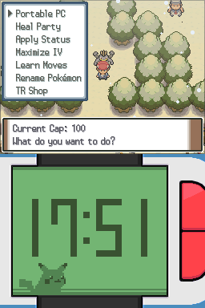
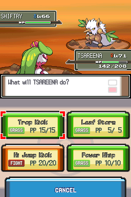
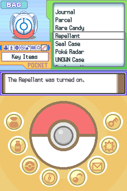
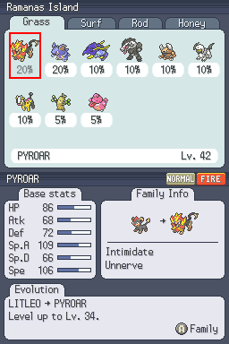
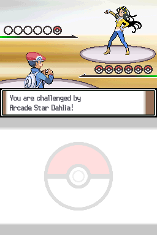
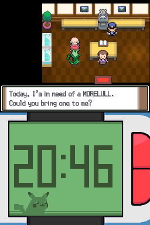

## About The Game

Tarnished Platinum is a difficulty hack of Pokémon Platinum, built with the [pokeplatinum decompilation](https://github.com/pret/pokeplatinum). The premise is simple: the Pokémon you are used to using over and over again (think of things like Infernape, Gliscor and Gyarados) are not available. Instead, you'll have to rely on a unique, curated roster of Pokémon, some of whom have received significant buffs, to win against new and challenging opponents.

  
  
  
  
  
  

## Game Features

- Gen 9 battle mechanics and held items (except critical hits, which still deal 2x damage)
- Custom Trainer AI
- Over 400 Pokémon available, including several from Gens 1-9
- Over 200 handcrafted trainer battles
- In-game cheat code system
- Built-in level caps
- Resource management system, requiring players to strategically decide when to use their items.
- Following Pokémon
- Over 50 new events and scripts
- New story elements
- Revamped Pokéradar

## QOL Features

- Portable PC, Auto-Heal, Move Relearner, Pre-Status and Name Rater, all from a single menu
- Infinite Rare Candy Item
- Permanent Repel
- HMs can be forgotten like regular moves
- BDSP-style helper system for HMS (except for Fly)
- Single button Pokéball throwing
- Pokénav item for viewing route encounters in-game
- Pokémon Info tab for viewing stats, typing, abilities and learnsets in-game

## Game Modes

- **Classic**: The traditional experience. Level caps are toggled on by default, and resources such as Heart Scales and Red Shards are limited.
- **Casual**: A more laid back experience that removes most of the mandatory trainers and gives you more Heart Scales.
- **Sandbox**: Same as classic mode, except with infinite Heart Scales and mints.
